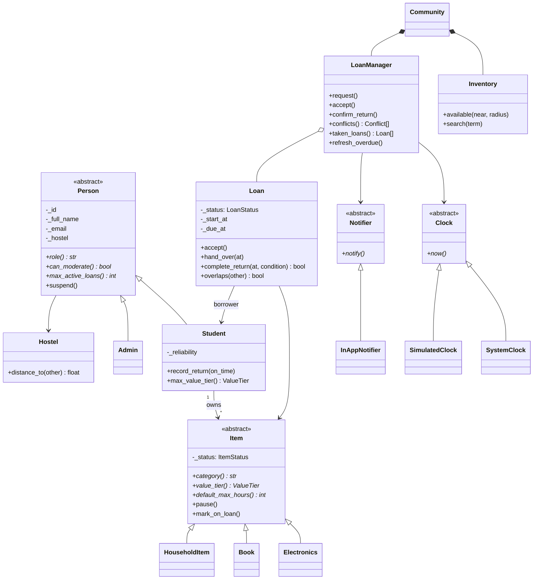
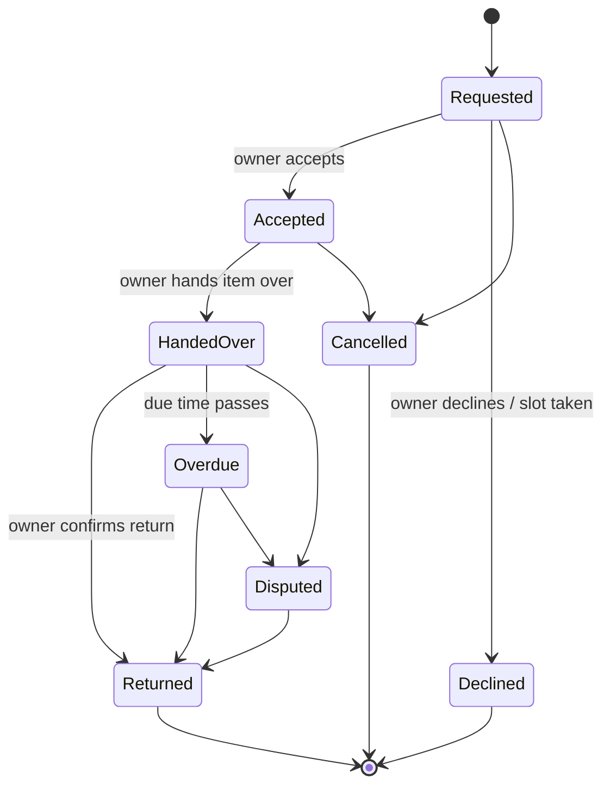

# BorrowMate

> **Why buy something you only need for an hour when someone in your hostel already has it?**

BorrowMate is a peer-to-peer borrowing system for university students. Students list everyday items they are not using (calculators, irons, extension cables, textbooks, umbrellas), and nearby students borrow them for a short, agreed time. Every loan is recorded, so everyone knows **who has what, and when it is coming back**.

This repository contains a working **command-line application written in Python using object-oriented programming**. It is a group project at Uganda Christian University (UCU), Mukono.

  

---

## Table of contents

1. [What the app does](#what-the-app-does)
2. [Quick start](#quick-start)
3. [Demo walkthrough](#demo-walkthrough)
4. [How OOP is used](#how-oop-is-used)
5. [Class diagram](#class-diagram)
6. [Loan life cycle](#loan-life-cycle)
7. [Business rules](#business-rules)
8. [Project structure](#project-structure)
9. [Running the tests](#running-the-tests)
10. [Team workflow](#team-workflow)
11. [Roadmap](#roadmap)

---

## What the app does

| Feature | What you see |
|---|---|
| **All listed items** | Every item, its status (Available, On loan, Paused) and, if it is out, who has it and when it is due back |
| **Available items near me** | Available items sorted by distance from your hostel, optional search radius, upcoming bookings, and whether *you* are allowed to borrow each one |
| **Taken items and return times** | Items currently with a borrower, when they were taken, the return deadline and a live countdown (`in 2h 30m` / `30m LATE`) |
| **Booking conflicts** | Overlapping bookings of the same item, labelled `COMPETING`, `BLOCKED` or `CLASH` |
| **Overdue items** | Loans past their deadline and how late they are |
| **Borrowing workflow** | Request → owner accepts/declines → handover → owner confirms the return and condition |
| **Trust ladder** | New students can only borrow low-value items; on-time returns unlock more |
| **Notifications** | An in-app inbox for every request, decision, handover, reminder and return |
| **Admin tools** | View disputed loans, suspend or restore users |
| **Demo clock** | Move time forward to watch loans become overdue |

## Quick start

You only need **Python 3.9 or newer**. There is nothing to install.

```bash
git clone https://github.com/Ndiku-leonald/borrow_mate.git
cd borrow_mate
python main.py            # demo data on a simulated clock (recommended)
python main.py --empty    # a fresh campus on the real clock
```

On Windows, use `py main.py` if `python` is not recognised.

## Demo walkthrough

The demo starts on **Tue 03 Nov, 10:30** with three hostels near UCU, five students and one moderator.

| Id | User | Try this |
|---|---|---|
| `U001` | Leo | Option **3**: see the iron he borrowed is **30 minutes late**. Option **2**: every item shows "You can borrow: no", because he has an overdue loan. |
| `U002` | Keitha | Option **10**, loan `L002`: confirm Leo returned the iron (recorded as a late return). |
| `U003` | Stacey | Option **4**: see the `COMPETING` conflict on her extension cable. Option **8**, loan `L003`: accept Keitha's request; Leo's overlapping request is declined automatically. |
| `U004` | Brian | Option **2**: a new student, so he can borrow low-value items but not the calculator. |
| `U006` | Moderator | Admin menu: disputes and account suspension. |

Example output from **Taken items and return times**:

```
=== Items currently taken ===
  Id   | Item                  | Borrower       | Owner          | Taken            | Return by        | Time left | Status
  -----+-----------------------+----------------+----------------+------------------+------------------+-----------+------------
  I002 | Electric iron         | Leo Ndikuryayo | Keitha         | Tue 03 Nov 09:00 | Tue 03 Nov 10:00 | 30m LATE  | Overdue
  I001 | Scientific calculator | Stacey         | Leo Ndikuryayo | Tue 03 Nov 09:00 | Tue 03 Nov 13:00 | in 2h 30m | Handed over
```

## How OOP is used

| Concept | Where to find it | What it does here |
|---|---|---|
| **Abstraction** | `Person`, `Item` (abstract base classes), `Clock`, `Notifier` | You cannot create a plain `Person` or `Item`; they define *what* every subclass must do. `LoanManager` depends on the abstract `Clock` and `Notifier`, not on specific implementations. |
| **Inheritance** | `Student`/`Admin` extend `Person`; `Electronics`/`Book`/`HouseholdItem` extend `Item`; every error extends `BorrowMateError` | Shared code lives once in the parent; children add or change only what is different. |
| **Polymorphism** | `role()`, `can_moderate()`, `max_active_loans()`, `category()`, `value_tier()`, `default_max_hours()`, `details()` | The same call gives a different answer per class. The CLI builds a **different menu for students and admins** without `if role == ...` checks on strings. |
| **Encapsulation** | Private attributes (`_status`, `_reliability`...) exposed through read-only `@property` | State only changes through methods that enforce rules: a loan cannot skip states, reliability stays between 0 and 5, and an item on loan cannot be paused. |
| **Composition** | `Community` owns `Inventory` and `LoanManager`; `Inventory` *has a* `Repository` | Big objects are built from smaller, focused ones. |
| **Generics** | `Repository[T]` | One store class reused for hostels, people, items and loans. |
| **Design patterns** | Factory (`ItemFactory`), Facade (`Community`), State machine (`Loan`), Dependency injection (`Clock`, `Notifier`, CLI input/output) | Keeps the code easy to extend and to test. |
| **Custom exceptions** | `borrowmate/exceptions.py` | The CLI catches one base error and shows a friendly message; tests check the exact error type. |

## Class diagram



The full product design (use case diagram and the complete future class diagram) is in [`docs/design`](docs/design).

## Loan life cycle



Any move not in this diagram raises `InvalidTransitionError`.

## Business rules

**Who can borrow:** a student, not suspended, not their own item, the item is not paused, they have **no overdue loans**, they are under their active-loan limit (1 for new students, 3 after two completed loans), and the item's value tier is within their trust level:

| Trust level | Requirement | Can borrow |
|---|---|---|
| Low | new account | books, household items |
| Medium | reliability ≥ 3.0 and 2+ completed loans | + everyday electronics |
| High | reliability ≥ 4.0 and 5+ completed loans | + high-value items (laptop chargers) |

Reliability starts at 3.0, rises by 0.2 for each on-time return, and falls by 0.5 for each late one.

**Conflicts:** two bookings conflict when they are for the same item and their time windows overlap (back-to-back bookings are fine).

- `COMPETING`: two pending requests want the same time. Allowed, but shown so the owner can choose. Accepting one **automatically declines** the other.
- `BLOCKED`: a request overlaps a confirmed booking. New requests like this are refused with a message saying when the item is free.
- `CLASH`: two confirmed bookings overlap. The rules prevent this; it is reported loudly if it ever happens.

**Accountability:** only the item's owner can hand it over and confirm its return, so a borrower cannot mark an item "returned" on their own. The return records the time (on time or late) and the item's condition.

**Privacy:** people are located by **hostel**, never by live GPS. Distances are hostel to hostel.

## Project structure

```
borrow_mate/
├── main.py                     # entry point
├── borrowmate/
│   ├── exceptions.py           # BorrowMateError and subclasses
│   ├── seed.py                 # demo scenario
│   ├── models/                 # the domain (what things ARE)
│   │   ├── enums.py            # ItemStatus, LoanStatus, ValueTier, Condition
│   │   ├── hostel.py           # Hostel + haversine distance
│   │   ├── person.py           # Person (abstract) -> Student, Admin
│   │   ├── item.py             # Item (abstract) -> Electronics, Book, HouseholdItem
│   │   └── loan.py             # Loan state machine
│   ├── services/               # the rules (what things DO)
│   │   ├── clock.py            # Clock (abstract) -> SystemClock, SimulatedClock
│   │   ├── repository.py       # Repository[T], IdGenerator
│   │   ├── notifier.py         # Notifier (abstract) -> InAppNotifier
│   │   ├── inventory.py        # Inventory, ItemFactory
│   │   ├── loan_manager.py     # eligibility, conflicts, overdue, Conflict
│   │   └── community.py        # facade that wires everything
│   └── cli/
│       ├── display.py          # tables and countdowns
│       └── app.py              # BorrowMateCLI menu
├── tests/                      # 31 unit tests (unittest, no extra packages)
└── docs/design/                # UML diagrams (PlantUML + Mermaid)
```

## Running the tests

```bash
python -m unittest discover -s tests -t .
```

The tests cover the OOP rules (abstract classes cannot be created, polymorphic answers, encapsulated state), the loan state machine, eligibility and the trust ladder, conflict detection, overdue handling, distance search, and scripted runs of the CLI.

## Team workflow

| Member | Branch |
|---|---|
| Leo (Ndikuryayo Leonald) | `leo-branch` |
| Keitha | their own branch |
| Stacey | their own branch |

1. Pull the latest `main` before starting: `git checkout main && git pull`.
2. Work on your own branch: `git checkout your-branch && git merge main`.
3. Make **small commits** with clear messages (`feat:`, `fix:`, `test:`, `docs:`, `refactor:`).
4. Run the tests before pushing.
5. Open a pull request into `main`; at least one teammate reviews it before merging.

## Roadmap

Good next pieces of work, each a natural pull request on top of this one:

- **Save and load** data to a JSON file (a `JsonRepository` with the same methods as `Repository`)
- **"I Need This" requests**: post a need and receive offers from people who have not listed the item
- **Loan extensions** (borrower asks, owner approves) and **ratings** after each loan
- **Due-soon reminders** (e.g. 15 minutes before the deadline)
- **Waitlist**: join a queue for an item that is out
- **Hostel Shelf**: communal items managed by a hostel custodian

---

*BorrowMate: Uganda Christian University, Faculty of Engineering, Design and Technology.*
